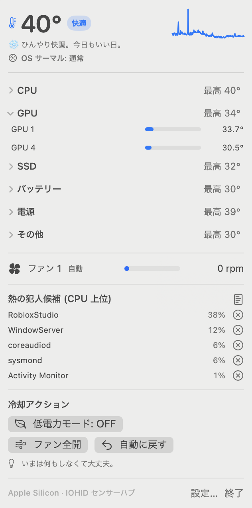

# ThermalPilot 🌡️

A menu bar app for macOS that shows **how hot your Mac is, what is causing it, and what to do about it** in one click.
Supports Apple Silicon (M1 to M5) and Intel Macs. Requires macOS 14 Sonoma or later.

<p align="center">
  
</p>

[日本語 README](README.md)

## Features

| Feature | How it works | Root |
|---|---|---|
| CPU / GPU / SSD / battery temperatures | Apple Silicon: IOHID sensor hub (same approach as macmon / Stats). Intel: AppleSMC | no |
| Fan RPM and mode | AppleSMC keys `FNum` `F0Ac` `F0Tg` `F0Mn` `F0Mx` `F0Md` | no |
| OS thermal pressure | `ProcessInfo.thermalState` (public API) | no |
| "Heat suspects": top CPU processes, terminate in place | `ps -Arcxo pid,pcpu,comm` + `kill` | no (own processes only) |
| Notification when it gets hot | UserNotifications with hysteresis, so thresholds do not flap | no |
| Low Power Mode toggle (optional auto-on at critical) | `pmset -a lowpowermode` through an admin authentication dialog | admin |
| Fan boost / restore auto / temperature-following curve | Bundled `thermalctl` CLI run with admin authentication. A boost started from the app can be restored to auto without a password. Handles the Apple Silicon `Ftst` unlock | **root** |
| `thermalctl status --json` from the terminal | Same engine, as a CLI | no |

### Philosophy

macOS already manages thermals almost perfectly on its own. What an app can actually do is:

1. **Stop the heat source**: find and terminate the runaway process. This is by far the most effective.
2. **Cut power**: Low Power Mode. Often drops 5 to 10 °C within minutes.
3. **Spin fans early**: ramp fans ahead of the quiet-first OS default to flatten peaks.

ThermalPilot ships 1 and 2 as core features and keeps 3 opt-in through `thermalctl`, because on Apple Silicon fan control is a tug-of-war with the OS and a wrong setting can damage hardware.

## Build and run

Requirements: macOS 14+, Xcode 16 or later (Swift 5.10+; Xcode 26 / Swift 6 also fine). No external package dependencies.

```bash
git clone https://github.com/tokoinx/ThermalPilot.git && cd ThermalPilot
./scripts/build-app.sh          # creates dist/ThermalPilot.app (ad-hoc signed, or your Apple Development cert if present)
open dist/ThermalPilot.app
```

During development `swift run ThermalPilot` works too (no bundle, so notifications fall back to NSLog).

Tests (policy logic, SMC codecs, sensor naming, ps parser, fan curve; no IOKit required, so they also run on Linux):

```bash
swift test
```

### CLI `thermalctl`

```bash
sudo ./scripts/install-cli.sh    # /usr/local/bin/thermalctl
thermalctl status                # temperatures, fans, top processes, advice
thermalctl watch --interval 2    # live view
thermalctl sensors --json        # all sensors as JSON
thermalctl keys T                # list SMC T* keys (diagnostics)
sudo thermalctl boost --minutes 5   # all fans to max, back to auto after 5 min
sudo thermalctl curve            # temperature-following fan curve (Ctrl-C restores auto)
sudo thermalctl auto             # back to automatic control
```

## Troubleshooting

| Symptom | Cause and fix |
|---|---|
| `zsh: killed ./scripts/build-app.sh` | Files extracted from a downloaded zip carry the quarantine attribute and Gatekeeper kills the script. Run `xattr -dr com.apple.quarantine ~/ThermalPilot` once, or start it as `bash scripts/build-app.sh` (the script now strips the attribute itself) |
| "cannot be opened because the developer cannot be verified" | Ad-hoc signature. Right-click → Open, or System Settings → Privacy & Security → Open Anyway. If Xcode is signed in, the free "Apple Development" certificate is picked up automatically and the warning disappears |
| Temperatures show "not detected" | Virtual machine, or IOHID blocked. Check `thermalctl keys T` for SMC-side keys |
| No fan section | Fanless Mac (MacBook Air) or SMC not found. Check with `thermalctl fans` |
| A button does nothing | Check the diagnostic logs: the app writes `~/Library/Logs/ThermalPilot.log` (AppleScript result and error), thermalctl writes `/var/log/thermalctl.log` (start, received signals, stop reason). |
| "Restore auto" does nothing after "Fan boost" | A bug in earlier versions: the boost loop kept re-applying. Now a boost started from the app is stopped through a stop file, and anything else through `sudo thermalctl auto`. If an old thermalctl is still running, run `sudo pkill -9 -f thermalctl`, then `sudo thermalctl auto` |

## Design notes

```
Sources/
  ThermalCore/          IOKit layer + pure logic (library)
    SMC.swift           AppleSMC read/write. 80-byte C struct laid out by hand
    HIDSensors.swift    IOHIDEventSystemClient (private API) resolved with dlsym
    SensorNaming.swift  "PMU tdie3" → "CPU die 3" labels and categories
    ThermalPolicy.swift thresholds, hysteresis, advice text, fan curve (unit tested)
    FanController.swift fan reading / manual control with Ftst unlock
    ProcessSampler.swift top CPU processes from ps
    ThermalEngine.swift bundles everything into one snapshot
  ThermalPilot/         SwiftUI MenuBarExtra app (Observation, macOS 14+)
  thermalctl/           CLI
Tests/ThermalCoreTests/ unit tests for the policy logic
scripts/                .app bundling, icon generation, CLI install
docs/RESEARCH.md        survey of prior projects, Claude Skills and SMC keys (Japanese)
.claude/skills/         Claude Code skill for future development
```

**Default thresholds**: Apple Silicon dies are designed to run past 100 °C, so defaults are higher than Intel (warm 65 / hot 85 / critical 100 °C; Intel 60 / 80 / 95 °C). Adjustable in Settings.

**Why osascript instead of a privileged helper**: FanBar, smctl and agoodkind/macos-smc-fan use an `SMAppService` daemon over XPC, which requires a **paid Apple Developer Program Developer ID**. ThermalPilot prioritises "anyone can build and run it", so root operations go through a per-action admin dialog instead. For continuous fan curves, run `sudo thermalctl curve` as a LaunchDaemon.

## Known limitations

- Fanless Macs show no fan section. Temperatures, processes and Low Power Mode still work.
- Virtual machines have no SMC / IOHID sensors; temperatures read "not detected".
- On Apple Silicon, `thermalmonitord` reclaims fan control within seconds. `boost` / `curve` keep re-applying in a loop, but sleep resets `Ftst`, so re-run after wake. M2 / M3 are untested (agoodkind's research covers M1 / M4 / M5).
- IOHIDEventSystemClient is a **private API**, so Mac App Store distribution is not possible. If a future macOS changes it, the app falls back to SMC reads.
- Forcing fans too low **can damage hardware**. `thermalctl` clamps to the hardware-reported min/max, but use at your own risk.

## Verification

As of 2026-11-08, on an Apple M1 Mac running macOS 14.8.3. Items not tested are marked "not verified".

| Item | Status |
|---|---|
| Build, app launch, menu bar display | Verified on Apple M1 |
| Unit tests | 14 passed on Apple M1. All 15, including one added later, pass on Linux with Swift 6.1 |
| Temperature reading (`thermalctl sensors`, IOHID) | Verified on Apple M1 |
| Fan control (`sudo thermalctl set` / `boost`) | Verified on Apple M1 |
| App "Fan boost" and password-free "Restore auto" | Verified on Apple M1 |
| Stopping the boost when the app quits (`--parent`) | Not verified |
| Fan curve (`sudo thermalctl curve`), Low Power Mode toggle, notifications | Not verified |
| Intel Macs, M2 / M3 / M4 / M5 | Not verified |

## License

MIT. SMC access follows beltex/SMCKit, hholtmann/smcFanControl and vladkens/macmon; the Apple Silicon fan control sequence follows agoodkind/macos-smc-fan (all MIT).
