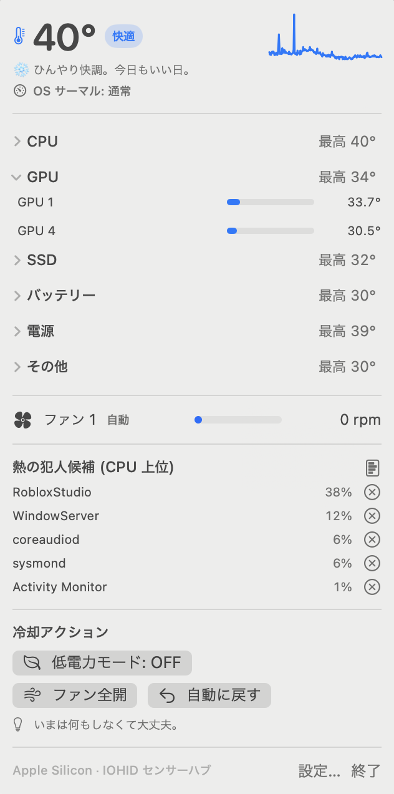

# ThermalPilot 🌡️

Mac が熱くなったとき、**「いま何度で、何が原因で、どうすれば冷えるか」** を 1 クリックで見せるメニューバーアプリ。
Apple Silicon (M1〜M5) と Intel Mac の両対応。macOS 14 Sonoma 以降。

<p align="center">
  
</p>

[English README](README.en.md)

## できること

| 機能 | 仕組み | root |
|---|---|---|
| CPU / GPU / SSD / バッテリー温度 | Apple Silicon: IOHID センサーハブ (macmon / Stats と同方式)。Intel: AppleSMC | 不要 |
| ファン回転数・モード表示 | AppleSMC `FNum` `F0Ac` `F0Tg` `F0Mn` `F0Mx` `F0Md` | 不要 |
| OS のサーマルプレッシャー表示 | `ProcessInfo.thermalState` (公開 API) | 不要 |
| 「熱の犯人」= CPU 上位プロセスの表示と終了 | `ps -Arcxo pid,pcpu,comm` + `kill` | 不要 (他ユーザーのプロセスは不可) |
| 熱くなったら通知 | UserNotifications。ヒステリシス付きで通知のバタつきを防止 | 不要 |
| 低電力モードの切替 (自動オンも可) | `pmset -a lowpowermode` を管理者認証ダイアログ経由で実行 | 認証 |
| ファン全開 / 自動復帰 / 温度追従カーブ | `thermalctl` (同梱 CLI) を管理者認証で実行。Apple Silicon の `Ftst` アンロック対応 | **root** |
| ターミナルから `thermalctl status --json` | 同じエンジンを CLI で | 不要 |

### 「温度管理」の考え方

Mac の温度は **OS (thermalmonitord) がほぼ完璧に自動管理** しています。アプリが直接下げられるのは、

1. **熱源を止める** — 暴走プロセスの特定と終了。これが一番効く。
2. **電力を絞る** — 低電力モード。数分で 5〜10℃ 下がることが多い。
3. **ファンを先回りで回す** — 静音優先の OS 既定より早めに回して、ピークを抑える。

の 3 つ。ThermalPilot は 1 と 2 を標準機能に、3 をオプトイン (`thermalctl`) にしています。
3 は Apple Silicon では OS と綱引きになるうえ、設定を誤るとハードウェアを傷めるので、既定ではオフです。

## ビルドと起動

必要なもの: macOS 14+, Xcode 16 以降 (Swift 5.10+。Xcode 26 / Swift 6 でも可)。外部パッケージ依存なし。

```bash
git clone https://github.com/tokoinx/ThermalPilot.git && cd ThermalPilot
./scripts/build-app.sh          # dist/ThermalPilot.app ができる (ad-hoc 署名)
open dist/ThermalPilot.app
```

開発中は `swift run ThermalPilot` でも動きます (バンドル無しなので通知は NSLog に落ちます)。

テスト (IOKit に依存しない判定ロジック・SMC 型変換・ps パーサ):

```bash
swift test
```

### CLI `thermalctl`

```bash
sudo ./scripts/install-cli.sh    # /usr/local/bin/thermalctl
thermalctl status                # 温度・ファン・上位プロセス・提案
thermalctl watch --interval 2    # ライブ表示
thermalctl sensors --json        # センサー一覧を JSON で
thermalctl keys T                # SMC の T* キーを列挙 (診断)
sudo thermalctl boost --minutes 5   # 全ファン最大、5 分後に自動復帰
sudo thermalctl curve            # 温度追従カーブ (Ctrl-C で自動へ復帰)
sudo thermalctl auto             # 自動制御に戻す
```

アプリには `thermalctl` が同梱されているので、ファン付きの Mac ではパネルに **「ファン全開 (10 分)」「自動に戻す」** ボタンが出ます。

- 「ファン全開」は `thermalctl boost` をバックグラウンドで起動し、10 分間 (または「自動に戻す」まで) 全開を維持します。実行中はパネルに「ブースト中」と出ます。
- 「自動に戻す」は、裏で動いている boost / curve を止めてから自動制御へ戻します。止めずに戻そうとしても 2 秒後に再設定されるため、必ずこの順番で処理しています。
- boost / curve は PID を `/var/run/thermalctl.pid` に記録します。ターミナルから `sudo thermalctl auto` でも同じように停止できます。

## トラブルシューティング

| 症状 | 原因と対処 |
|---|---|
| `zsh: killed ./scripts/build-app.sh` | zip から展開したファイルに隔離属性が付いており、Gatekeeper がスクリプトを kill している。`xattr -dr com.apple.quarantine ~/ThermalPilot` を 1 度実行 (build-app.sh も自動で外すようになったので、`bash scripts/build-app.sh` と bash 経由で起動すれば通る) |
| 「開発元を確認できないため開けません」 | ad-hoc 署名のため。右クリック →「開く」、または システム設定 → プライバシーとセキュリティ →「このまま開く」。Xcode にサインインしていれば無料の "Apple Development" 証明書が自動で使われ、この警告は出ない |
| 温度が「未検出」 | 仮想マシン、または IOHID が塞がれた環境。`thermalctl keys T` で SMC 側のキーがあるか確認 |
| ファン欄が出ない | ファンレス機 (MacBook Air) か SMC 未検出。`thermalctl fans` で確認 |
| 更新したのに挙動が変わらない | `open` は同じ ID のアプリが起動中だと **古い方を前面に出すだけ** で新しいビルドを起動しません。build-app.sh が起動中のアプリを自動終了するようにしたので、ビルド後に `open` し直してください。新版は別の場所にある旧版を起動時に終了させます |
| 「自動に戻す」を押しても戻らない | v0.1.0 の既知バグ (boost ループが生き残っていた)。最新版では `auto` が先に boost を止めます。古い版が動いたままなら `sudo pkill -f "thermalctl boost"` |

## 初回起動時に出るもの

- **通知の許可** — 「アツい」以上で通知するため。
- **管理者パスワード** — 低電力モード切替・ファン制御を押した時だけ。SMC への書き込みと `pmset` は root 必須のためです。
- Gatekeeper の警告 — ad-hoc 署名のため。右クリック →「開く」で通過できます。Developer ID をお持ちなら `SIGN_IDENTITY="Developer ID Application: ..." ./scripts/build-app.sh` で署名できます。

## 設計メモ

```
Sources/
  ThermalCore/          IOKit 層 + 純粋ロジック (ライブラリ)
    SMC.swift           AppleSMC 読み書き。80 バイトの C 構造体を手動レイアウト
    HIDSensors.swift    IOHIDEventSystemClient (非公開 API) を dlsym で呼ぶ
    SensorNaming.swift  "PMU tdie3" → 「CPU ダイ 3」などの命名とカテゴリ分け
    ThermalPolicy.swift しきい値・ヒステリシス・提案文・ファンカーブ (テスト対象)
    FanController.swift ファン読み取り / Ftst アンロック付き手動制御
    ProcessSampler.swift ps の出力から CPU 上位プロセス
    ThermalEngine.swift 上記を束ねて 1 スナップショットに
  ThermalPilot/         SwiftUI MenuBarExtra アプリ (Observation, macOS 14+)
  thermalctl/           CLI
Tests/ThermalCoreTests/ 判定ロジックのユニットテスト
scripts/                .app バンドル化・アイコン生成・CLI インストール
docs/RESEARCH.md        GitHub 調査レポート (先行プロジェクト・Skills・SMC キー)
.claude/skills/         今後の開発用 Claude Code Skill
```

**しきい値の既定値** — Apple Silicon はダイ温度 100℃ 超まで許容する設計なので、Intel より高めにしています (ほんのり 65 / アツい 85 / 危険 100℃。Intel は 60 / 80 / 95℃)。設定画面で変更できます。

**なぜ特権ヘルパーではなく osascript か** — FanBar / smctl / agoodkind の実装は `SMAppService` の特権デーモン + XPC ですが、これには **有料 Apple Developer Program の Developer ID 署名が必須** です。ThermalPilot は誰でもビルドして使えることを優先し、root 操作はその都度の管理者認証 (osascript) にしています。常時のファンカーブ制御をしたい場合は `sudo thermalctl curve` を LaunchDaemon 化してください。

## 既知の制限と注意

- **ファンレス機 (MacBook Air など)** はファン欄が出ません。温度・プロセス・低電力モードは使えます。
- **仮想マシン** では SMC / IOHID センサーが無く、温度は「未検出」になります。
- **Apple Silicon のファン制御** は thermalmonitord が数秒〜数十秒で制御を取り戻します。`boost` / `curve` はループで再設定し続けますが、スリープ復帰で `Ftst` がリセットされるため、再実行が必要です。M2 / M3 では未検証 (agoodkind の研究に M1 / M4 / M5 の実測のみ)。
- IOHIDEventSystemClient は **非公開 API** です。Mac App Store 配布はできません。将来の macOS で変わる可能性があり、その場合は SMC 読み取りにフォールバックします。
- ファンを手動で下げすぎると **ハードウェアを傷めます**。`thermalctl` はハードウェア報告の Min/Max で clamp しますが、自己責任でお使いください。

## 検証状況

| 対象 | 状態 |
|---|---|
| `ThermalCore` (判定ロジック・SMC 型変換・センサー命名・ps パーサ・ファンカーブ) | Linux + Swift 6.1 で **ビルドとユニットテスト 14 件が通過** |
| `thermalctl` | Linux でビルド・起動を確認 (IOKit の無い環境ではフォールバック表示) |
| `ThermalPilot.app` (SwiftUI / AppKit / IOKit の実体) | **macOS 実機では未コンパイル**。Linux の Claude Code セッションで実装したため |

macOS 実機では次の順で確認してください:

```bash
swift build                      # アプリ本体を含む全ターゲット
swift test                       # 14 件 + 実機で増やす分
swift run thermalctl sensors     # IOHID / SMC の生の値が取れるか
./scripts/build-app.sh && open dist/ThermalPilot.app
```

詰まった時は [docs/RESEARCH.md](docs/RESEARCH.md) の参照実装 (macmon / FanBar / smctl) が同じ API を使っています。
`Package.swift` は macOS 以外のホストではアプリターゲットを除外するので、Linux CI でもコアのテストが回せます。

## ライセンス

MIT。SMC アクセスの考え方は beltex/SMCKit, hholtmann/smcFanControl, vladkens/macmon, Apple Silicon のファン制御手順は agoodkind/macos-smc-fan (いずれも MIT) を参考にしています。
